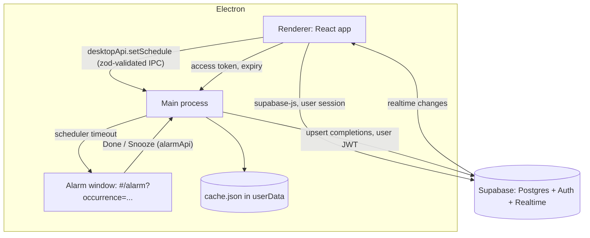

<div align="center">
  <h1>Alarm Calendar</h1>
  <p>
    <em>A personal calendar whose alarms take over the screen until you press Done or Snooze.</em>
  </p>

  
  
  
  
</div>

## What it is

Notifications are easy to swipe away, so habits that depend on them die quietly. Alarm Calendar replaces the notification with a full-screen alarm: sound looping, the event title, two buttons. Closing the window re-opens it after a refire interval. Snoozes are limited per event, and an event with zero snoozes has no snooze button at all.

Skipping is possible, but it costs something. A wallet of cheat passes (one granted per week, capped at two) silences every skippable event on a chosen day. The wallet lives in Postgres behind RPCs, so the client cannot grant itself a pass.

It is a single-user app. The Windows build is done; the Android build is blocked on the toolchain (see [Android status](#android-status)).

## Features

**Recurrence** — Events repeat every N hours, days, weeks (with chosen weekdays) or months. Hours use absolute intervals, the rest use wall-clock time in the user's zone, so 08:00 stays 08:00 across DST. A monthly event on the 31st lands on the last day of shorter months.

**Calendar** — Week, Month and Agenda views on FullCalendar, fed by the same recurrence function the alarm engine uses.

**Alarm engine (Electron)** — The scheduler runs in the main process with one timeout aimed at the soonest alarm, a 30 second re-check, and re-evaluation on resume and unlock. Alarms fire with the window closed, the screen asleep and no network.

**Snooze limits** — `max_snoozes` from 0 to 10 per event. The button reads "Snooze 5 min (2 left)" and disappears at the limit.

**Cheat passes** — Weekly grant, cap of 2, multi-week catch-up, spend on today or a future day, refund for future days only. Events marked non-passable (medication, say) ring anyway.

**Offline-first sync** — The main process caches the schedule in `userData`, queues completions, and flushes them to Supabase with an idempotent upsert. Realtime updates keep other devices current.

**Sign-in by emailed code** — Six-digit OTP through Supabase Auth. No magic links, so there is no redirect to catch inside Electron.

**Tray app** — Closing the window hides to the tray. Quit is disabled while an alarm is ringing or snoozed. Autostart is a Settings switch.

## Screenshots


_Week view with a recurring event and a cheat day shown as a striped column._


_The full-screen alarm with the snooze counter._

## How it works



The React app talks to the platform through one interface, `AlarmAdapter`. `ElectronAlarmAdapter` is implemented; `CapacitorAlarmAdapter` waits on the Android project.

```ts
interface AlarmAdapter {
  setSchedule(events, cheatDays, settings, completions?): Promise<void>;
  drainCompletions(): Promise<CompletionRow[]>;
  getPermissionStatus(): Promise<PermissionStatus>;
  openPermissionSettings(): Promise<void>;
}
```

Monorepo layout:

```
packages/core/        pure TS: recurrence, snooze, wallet logic, shared JSON test vectors
app/                  Vite + React + shadcn/ui shared UI (calendar, event form, settings, alarm screen)
electron/             main process: scheduler, alarm window, tray, cache, completion flusher, packaging
supabase/migrations/  schema, RLS, wallet RPCs
supabase/tests/       SQL checks run against the linked project
android/              not created yet
docs/                 spec.md, decisions.md, acceptance.md
```

### Key decisions

- **Scheduler in the main process**: alarms are driven by Electron's main process over a renderer timer because the main window can be closed or crashed and the alarm still has to ring. The renderer pushes the schedule over a zod-validated IPC call; main drops invalid rows one at a time so a single bad event cannot freeze the rest.
- **Wallet in Postgres RPCs**: `sync_wallet`, `use_pass` and `refund_pass` run as `security definer` functions over client-side counters because the point of a pass is that you cannot hand yourself one. The wallet snapshots its own timezone and week start, so changing the zone cannot farm passes. Details in [docs/decisions.md](docs/decisions.md).
- **RLS on every table, no write path to the wallet**: `pass_wallet` and `cheat_days` have no insert, update or delete grants for `authenticated`; `settings` allows column-level updates only. `supabase/tests/security_checks.sql` asserts this against the live catalog.
- **Main is the single owner of completion writes**: main flushes completions with `ON CONFLICT DO NOTHING` over letting the renderer and main both upsert, which would write twice. The first completion wins, a duplicate counts as success.
- **Main never holds the refresh token**: the renderer refreshes the session and hands main only the access token. Two clients refreshing one rotating refresh token get the session revoked.
- **One recurrence function, shared vectors**: a pure TS function backed by a JSON file of test vectors that the Kotlin mirror must also pass, rather than hand-checked cases per platform.

## Tech stack

| Technology | Role | Why |
| --- | --- | --- |
| React + Vite + TypeScript | Shared UI | One UI for Electron and Capacitor |
| shadcn/ui (`b0` preset), lucide-react | Components, icons | No native form controls anywhere |
| FullCalendar | Week / Month views | Occurrences come from our own recurrence function, not its rrule plugin |
| Electron 44 | Windows shell | Main-process scheduler outlives the window |
| electron-builder 26 | Installer | See [decisions.md](docs/decisions.md): config-only NSIS output and built-in fuses |
| Supabase | Postgres, Auth, Realtime | No custom backend; RLS does the enforcement |
| esbuild | Bundles main + preloads | Runs the TS-source workspace package inside Electron with no compile step |
| date-fns, zod, zustand, vitest | Time math, validation, state, tests | — |

## Getting started

### Prerequisites

- Node.js 22 or newer
- pnpm 11 (`corepack enable` picks it up from `packageManager`)
- [Supabase CLI](https://supabase.com/docs/guides/cli)
- A Supabase project

### Install

```bash
pnpm install
```

### Supabase

```bash
supabase login
supabase link --project-ref SUPABASE_PROJECT_REF   # may prompt for the database password; typed, never stored
supabase db push
```

Then in the dashboard:

1. Authentication > Providers: enable Email.
2. Authentication > Emails > SMTP Settings: enable **custom SMTP**. Supabase only lets you edit templates with your own SMTP; a Gmail app password works (`smtp.gmail.com`, port 465). The built-in sender is also limited to a few emails per hour.
3. Authentication > Email Templates: edit the **Magic Link** template (and **Confirm signup**) so the body contains `{{ .Token }}`. Sign-in is by code entry.
4. The app expects an **8-digit** code, the project default (Authentication > Sign In / Providers > Email > Email OTP Length). If you change that length, change `CODE_LENGTH` in `app/src/features/auth/auth-screen.tsx` to match.
5. Sign in once with your email so the owner account exists, then turn **sign-ups off** (Authentication > Sign In / Providers > Allow new users to sign up). Nobody else can create an account after that.

Supabase's built-in email sender is heavily rate limited. That is fine for one user.

Optional checks against the linked project (each rolls back or only reads):

```bash
supabase db query --linked -f supabase/tests/wallet_rpcs.test.sql
supabase db query --linked -f supabase/tests/security_checks.sql
```

### Configuration

```bash
cp app/.env.example app/.env
```

| Variable | Required | Description |
| --- | --- | --- |
| `VITE_SUPABASE_URL` | Yes | `https://SUPABASE_PROJECT_REF.supabase.co`. The Electron build bakes this origin in as the only host the CSP and the session hand-off allow. |
| `VITE_SUPABASE_PUBLISHABLE_KEY` | Yes | The `sb_publishable_...` key. It is designed to ship in clients and is protected by RLS. |

There is no custom backend. No secret key, service role key or JWKS URL is used anywhere, and none belongs in `app/`, `electron/` or `android/`: everything in those folders ships inside the app. `.env` files are gitignored; only `.env.example` is committed.

### Develop

Commands run from the repo through [go-task](https://taskfile.dev). From the personal workspace root they are `task alarm-calendar:<name>`; inside this folder, `task <name>`.

| Task | What it does |
| --- | --- |
| `dev` | React app in the browser on port 3021 |
| `electron` | Electron against the Vite dev server (starts Vite if it is not up) |
| `electron:seed` | Same, plus two test alarms about 1 and 1.5 minutes after launch |
| `electron:reset` | Wipes the dev cache, then seeds |
| `build` | Builds the React app and the Electron main bundle |
| `electron:built` | Runs Electron from the built `app/dist` over the `app://` protocol |
| `package` | Builds everything and produces the Windows installer |
| `test` | Runs every workspace test suite |

Dev data lives in `%APPDATA%\alarm-calendar-dev` and never touches an installed app's data. Electron flags and the full desktop notes are in [electron/README.md](electron/README.md).

### Test

```bash
pnpm -r test            # core, app and electron suites
pnpm -r typecheck
```

How each acceptance item from the spec is verified, automated or manual, is in [docs/acceptance.md](docs/acceptance.md).

## Packaging (Windows)

```bash
task package
```

This builds `app/dist`, bundles the Electron main process, and runs electron-builder (NSIS, x64, per-user). The output is `electron/release/Alarm-Calendar-Setup-<version>.exe` (about 112 MB, gitignored).

- **Install**: per-user, no administrator prompt. It starts the app after installing. On first run the app registers itself for login (hidden, in the tray); the Settings switch turns that off.
- **Contents**: the main bundle and preloads sit in `app.asar`; the built React app, sounds included, sits in `resources/app-dist`.
- **Fuses**: `RunAsNode`, `EnableNodeCliInspectArguments` and `EnableNodeOptionsEnvironmentVariable` are off; `OnlyLoadAppFromAsar` and `EnableEmbeddedAsarIntegrityValidation` are on.
- **Not signed.** There is no code-signing certificate, so Windows SmartScreen shows "Windows protected your PC" on first run. Choose **More info**, then **Run anyway**.
- The Supabase URL comes from `VITE_SUPABASE_URL` in the environment or `app/.env` at build time. The build prints neither the key nor the file.

## Known limits

- **Exclusive-fullscreen games.** Always-on-top does not draw over them. Run matches in borderless windowed mode. The sound and the taskbar flash still happen.
- **Lock screen.** On Windows the alarm window does not appear over the lock screen. While locked you get the sound and a taskbar flash; the window is there when you unlock.
- **Killing the process silences alarms.** Task Manager or `taskkill` stops every alarm until the app runs again. Autostart relaunches it after a reboot or logoff, and an alarm that was ringing or snoozed when the process died rings again at launch.
- **First completion wins.** If two devices complete the same occurrence, the row that arrived first is kept, including its snooze count.
- **Sign-out keeps the schedule.** Signing out stops syncing but leaves the cached schedule, so alarms keep ringing until another account signs in. Event titles stay in `cache.json` until then.
- **Passes need the internet.** Spending or refunding a pass is an RPC call; offline, the existing cheat days still apply.

## Android status

Blocked. There is no Android SDK on the development machine, so the `android/` project (Capacitor shell plus the Kotlin `AlarmEngine` plugin: `AlarmManager.setAlarmClock`, foreground service, full-screen intent, boot receiver, and the permission dialog flow) has not been created. Nothing here has been built or run on a device. The acceptance items that depend on it are marked blocked in [docs/acceptance.md](docs/acceptance.md).

Planned APK build, not yet built or verified:

```bash
pnpm --filter app build
pnpm --filter app exec cap sync android
cd android
./gradlew assembleDebug      # debug APK: android/app/build/outputs/apk/debug/
./gradlew assembleRelease    # needs a signing keystore (gitignored: *.keystore, *.jks)
```

## Roadmap

| Status | Item |
| --- | --- |
| Done | Core recurrence, snooze and wallet logic with shared test vectors |
| Done | Supabase schema, RLS and wallet RPCs |
| Done | Electron alarm engine, tray, autostart, offline cache |
| Done | React app: auth, event form, Week / Month / Agenda, passes, settings |
| Done | Windows NSIS installer |
| Blocked | Android alarm engine and APK, waiting on the Android SDK |
| Planned | Code signing for the Windows installer, to remove the SmartScreen warning |

## License

No license file yet. See the checklist below.

Built by Yassine Krichen · 2026

## Before You Publish

- [ ] Add `docs/demo/week.png` and `docs/demo/alarm.png`, referenced in Screenshots.
- [ ] Add a `LICENSE` file. MIT is the fit for a solo project; the line above says none exists.
